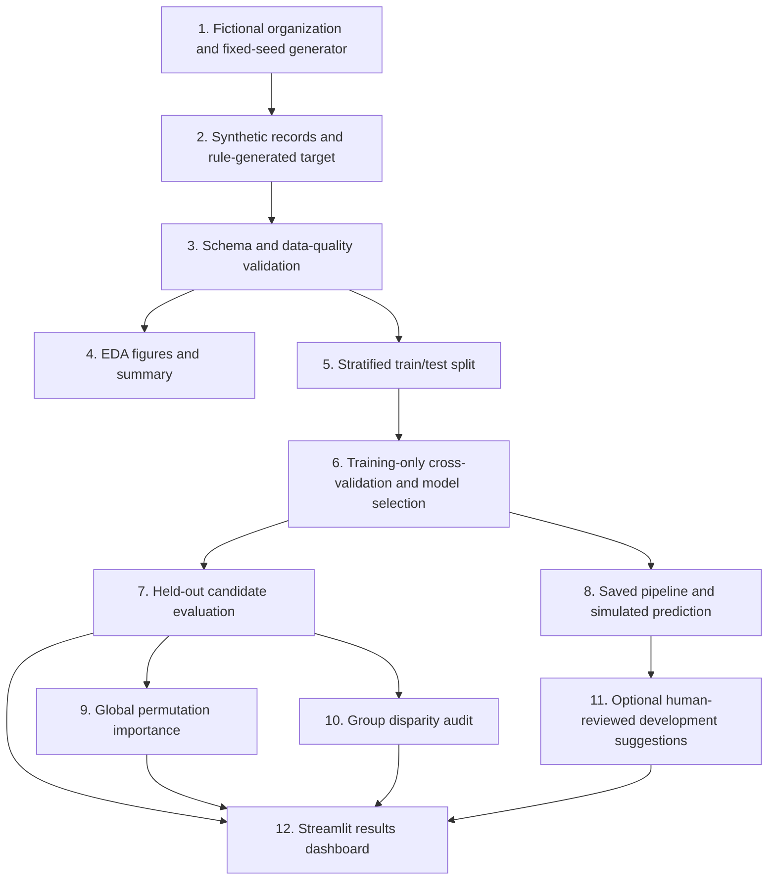

# Architecture and virtual simulation

## End-to-end simulation

The example uses a fictional organization and synthetic records; there is no connection to an actual employer.

1. Generate fictional employee records with `src/data_generator.py`.
2. Generate the simulated `perf_band_next` target from documented feature rules, quantile thresholds, and random noise.
3. Validate schema, types, ranges, duplicates, missing data, and target labels.
4. Run EDA to create saved charts and a concise report.
5. Split the one-row-per-fictional-employee dataset into stratified training and test sets.
6. Compare a DummyClassifier, Logistic Regression, and Random Forest; choose by five-fold training-only macro-F1.
7. Evaluate the candidates on the held-out test set and persist real metrics.
8. Load the fitted pipeline to generate an optional simulated prediction.
9. Measure global feature importance through permutation on the held-out data.
10. Audit held-out group disparities by gender, department, and job level.
11. Offer optional, non-punitive development suggestions from supported input signals.
12. Browse the generated artifacts and run a demonstration prediction in Streamlit.

## Flow diagram

## Components

- `src/config.py`: project-relative paths and schema constants.
- `src/data_generator.py`: fixed-seed fictional record and target generation.
- `src/data_validation.py`: reusable validation and safe CSV loading.
- `src/preprocessing.py`: imputation, scaling, and safe one-hot encoding in a pipeline.
- `src/eda.py`: actual EDA figures and plain-text summary.
- `src/train_model.py`: training-only CV, final estimator selection, and pipeline persistence.
- `src/evaluate_model.py`: held-out model metrics, confusion matrices, and coordinated explainability/audit reports.
- `src/explainability.py`: global permutation importance on the deterministic holdout.
- `src/fairness_audit.py`: held-out group-level metrics with sample-size guard.
- `src/predict.py`: feature-schema validation and saved-model inference.
- `src/recommendations.py`: optional supported-signal development summary.
- `app.py`: Streamlit interface; it reads reports/model files and never trains on refresh.

There is one synthetic record per fictional employee, so group-aware employee splitting is not necessary here. This assumption must be revisited if repeated time records are added.

**Validation boundary:** the model learns patterns in synthetic data and has not been validated for real employee appraisals. Scores, probabilities, importance rankings, and group metrics describe this controlled simulation only.
